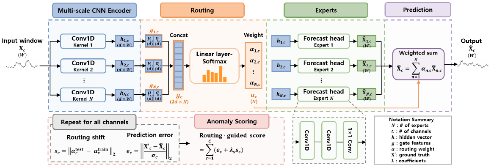
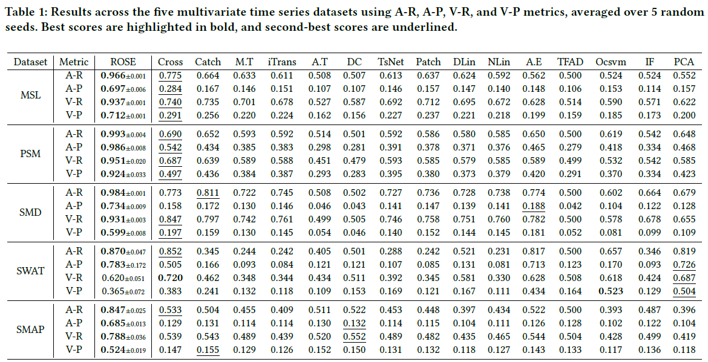

# ROSE: Routing Shift of Experts for Multivariate Time Series Anomaly Detection

## Abstract

Multivariate time series anomaly detection is commonly approached using forecasting or reconstruction models, where anomalies are identified based on prediction errors. However, modern models can accurately predict not only normal patterns but also anomalous ones, making prediction error an unreliable signal for anomaly detection. To address this limitation, we propose ROSE, a routing shift-based anomaly detection framework that leverages the internal behavior of mixture-of-experts models. Our key insight is that even when prediction errors are small, anomalies cause shifts in how the model routes inputs to experts. ROSE captures these routing shifts and detects anomalies by identifying deviations from normal expert routing patterns. We strengthen the reliability of this signal in two ways. First, we design the multi-scale CNN encoder as a learned filterbank, where each convolutional branch specializes in a distinct frequency band, and prove that routing shift is strictly positive whenever the model’s internal representation deviates from the training distribution. Second, we introduce a Bures-Wasserstein alignment objective that preserves the statistical structure of normal data, enabling the identification of subtler anomalies. Experiments on real-world benchmarks show that ROSE consistently outperforms 15 strong baselines, particularly on subtle anomalies where prediction errors remain small. Our results demonstrate that modeling routing shift as an anomaly signal provides a robust, theoretically grounded alternative to prediction errorbased approaches, offering a new perspective on anomaly detection by focusing on internal model behavior.

## Repository layout

```
your-repo/
└── rose/
    ├── __init__.py
    ├── convhead_model.py      # ROSE architecture
    ├── model.py               # loss, windows, scoring
    ├── utils.py               # data I/O, eval helpers
    ├── train_eval_convhead.py # train + evaluate ROSE
    ├── requirements.txt
    └── README.md
```

## Data

`--data_dir` must contain these four files:

```
train.npy
train_label.npy
test.npy
test_label.npy
```

Example:

```
datasets/MTS/PSM/AllInOne/train.npy
datasets/MTS/PSM/AllInOne/train_label.npy
...
```

Datasets are not bundled with this repo. Download them from [KAN-AD datasets](https://github.com/issaccv/KAN-AD) (or your own copy) and pass the real path to `--data_dir`.

**Mars Science Laboratory (MSL)** ([source](https://www.kaggle.com/datasets/patrickfleith/nasa-anomaly-detection-dataset-smap-msl))

**Soil Moisture Active Passive (SMAP)** ([source](https://www.kaggle.com/datasets/patrickfleith/nasa-anomaly-detection-dataset-smap-msl))

**Server Machine Dataset (SMD)** ([source](https://github.com/NetManAIOps/OmniAnomaly/tree/master/ServerMachineDataset))

**Secure Water Treatment (SWaT)** ([source](https://itrust.sutd.edu.sg/testbeds/secure-water-treatment-swat/))

**Pooled Server Metrics (PSM)** ([source](https://github.com/eBay/RANSynCoders))

---

## 1. Create a virtual environment

### Linux / macOS

```bash
cd your-repo
python3 -m venv .venv
source .venv/bin/activate
```

### Windows (PowerShell)

```powershell
cd your-repo
python -m venv .venv
.\.venv\Scripts\Activate.ps1
```

When the environment is active, the prompt shows `(.venv)`.

---

## 2. Install packages

```bash
pip install --upgrade pip
pip install -r rose/requirements.txt
```

If `requirements.txt` lives at the repo root instead: `pip install -r requirements.txt`.

---

## 3. Train and evaluate

Run from the **parent directory of `rose/`**.

```bash
cd your-repo
```

### MSL

```bash
python -m rose.train_eval_convhead \
  --data_dir datasets/MTS/MSL/AllInOne \
  --out_dir outputs/rose_msl \
```

## 4. Outputs

### Terminal
- **A-R** — AUC-ROC
- **A-P** — AUC-PR
- **V-R** — VUS-ROC
- **V-P** — VUS-PR

### Files under `--out_dir`

| File | Description |
|------|-------------|
| `metrics.json`, `metrics.csv` | Evaluation metrics |
| `scores.npz` | Train/test window scores, point scores, etc. |
| `alpha_train_mean.npy` | Routing reference from normal train windows |
| `anomaly_plot.png` | Time series + anomaly score plot |

The trained weights are saved at `--checkpoint` (`.pt`).

---

## Requirements

- Python >= 3.10
- `torch`, `numpy`, `matplotlib`, `scipy`, `easytsad` (see `requirements.txt`)

## Model Architecture



## Main Result

